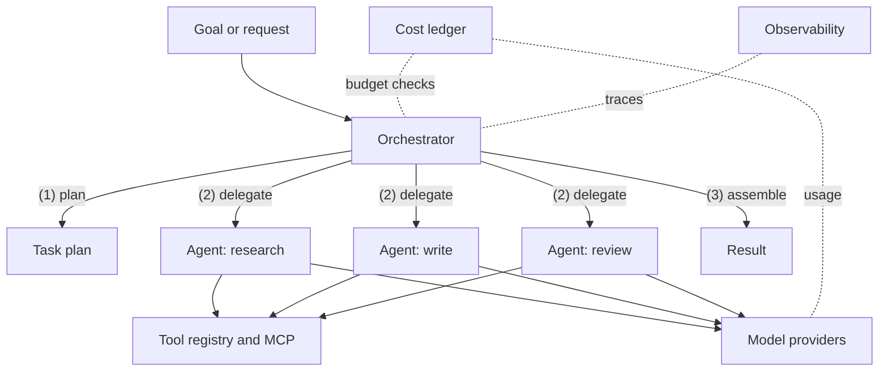

# Mainspring

**A production-ready orchestration framework for agentic AI systems.**

In a mechanical watch, the mainspring is the coiled spring that stores energy and drives every gear. You never see it, but nothing moves without it. Mainspring plays the same role for AI agents: a dependable core that plans work, hands it to specialized agents, and keeps the whole system running reliably and within budget.

> **Status:** Early development. APIs are not yet stable, and the design described below may change. Feedback and issues are welcome.

---

## Why Mainspring?

Most agent frameworks make it easy to build a demo. Far fewer make it easy to run agents in production, where cost, reliability, and visibility matter as much as capability. Mainspring is designed around three goals:

- **Production readiness**: predictable behavior, structured error handling, retries, and clear failure modes
- **Scalability**: modular components that can be scaled, swapped, or distributed independently
- **Cost efficiency**: token and cost tracking built into the core, with budgets enforced rather than merely reported

Its architecture follows orchestrator-and-worker principles: a planner breaks a goal into tasks, and focused agents carry them out. Each component has a single, clear responsibility.

## Features

- **Orchestrator**: plans tasks, delegates them to agents, and assembles the results
- **Specialized agents**: small, focused workers, each responsible for one kind of job
- **Tool registry**: a single place to register tools and integrations, with first-class support for the Model Context Protocol (MCP)
- **Cost controls**: per-run token and cost tracking, with budget limits that stop work before it overspends
- **Observability**: structured logs and traces, with OpenTelemetry export
- **Model-agnostic**: pluggable providers, including Anthropic, AWS Bedrock, and OpenAI
- **Self-hosted**: runs on your own infrastructure, with no external service required

## Architecture



| Component       | Responsibility                                               |
| --------------- | ------------------------------------------------------------ |
| Orchestrator    | Breaks goals into tasks, assigns them, and assembles results |
| Agents          | Carry out one focused kind of task each                      |
| Tool registry   | Registers tools and integrations, including MCP servers      |
| Model providers | Connect to the LLM backends of your choice                   |
| Cost ledger     | Tracks token usage and cost, and enforces budgets            |
| Observability   | Emits structured logs, traces, and metrics                   |

## Current state

The features above describe the target design. What exists today:

- **API** (`api/main.py`): FastAPI app with `GET /health` and `POST /agent/query`
- **Orchestrator** (`orchestrator/core.py`): a single LLM call per query over the OpenAI chat completions API, retrying only transient errors (timeouts, network errors, 429, 5xx)
- **Cost tracking** (`billing/`): per-call cost from per-model prices in `billing/prices.json`; budgets are not enforced yet

## Development

Requires [uv](https://docs.astral.sh/uv/).

```bash
uv sync
cp .env.example .env   # add your OPENAI_API_KEY
uv run --env-file .env uvicorn api.main:app --reload
```

```bash
curl -X POST localhost:8000/agent/query \
  -H 'Content-Type: application/json' \
  -d '{"query": "What is a mainspring?"}'
```

`LLM_MODEL` must have an entry in `billing/prices.json`, or the app will not start.

To skip `--env-file` on every command, set [`UV_ENV_FILE`](https://docs.astral.sh/uv/reference/environment/#uv_env_file) in your shell profile so `uv run` loads `.env` automatically:

```bash
export UV_ENV_FILE=.env
```

Run the tests (no API key or network needed):

```bash
UV_NO_ENV_FILE=1 uv run pytest   # or just `uv run pytest` if UV_ENV_FILE is unset
```

## Installation

```bash
uv add mainspring
```

> Packages will be published once the first preview release is ready.

## Quick start

A quick-start example will be added with the first preview release. It will show how to:

1. Configure a model provider
2. Register a tool
3. Define two or three agents
4. Run a goal through the orchestrator with a cost budget

## Roadmap

- [ ] Core orchestrator and task planning
- [ ] Agent interface and reference agents
- [ ] Tool registry with MCP support
- [ ] Cost ledger with budget enforcement
- [ ] OpenTelemetry tracing
- [ ] Provider adapters: Anthropic, AWS Bedrock, OpenAI
- [ ] First preview release
- [ ] Documentation site

## Contributing

Mainspring is not accepting pull requests until the first preview release, while the core design settles. Issues, bug reports, and design feedback are welcome in the meantime.

Once contributions open, they will be accepted under the [Developer Certificate of Origin](https://developercertificate.org/).

## License

Mainspring is licensed under the [Apache License 2.0](LICENSE). Redistributions must keep the [NOTICE](NOTICE) file.

## Author

Created and maintained by [Shayne Meyer](https://github.com/shaynemeyer).
